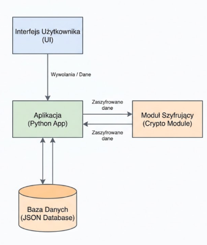
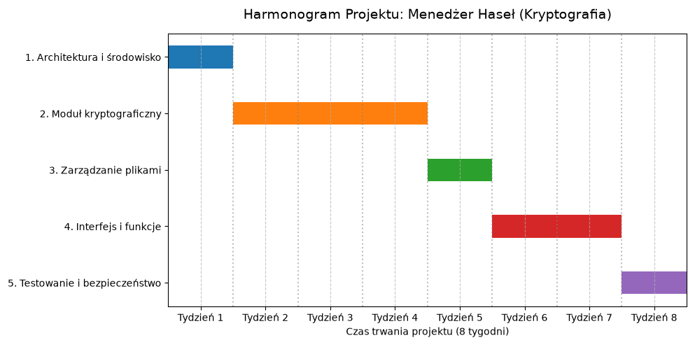

**Skład:**
Antoni Łukasiewicz
Wiktor Leszczyński
Jan Malinowski

**Temat:**
Menedżer haseł z lokalną bazą danych. Aplikacja przechowująca hasła użytkownika w zaszyfrowanym pliku JSON. Wykorzystanie funkcji PBKDF2 do wyprowadzenia klucza z hasła głównego oraz algorytm AES w trybie CBC do szyfrowania bazy.

**Stos technologiczny:**

* Język: Python 3

* Kryptografia: Biblioteka hashlib

* UI: Biblioteka Tkinter

* Przechowywanie danych: JSON

* Version Control: GitHub

**Schemat architektury aplikacji:**

**Plan etapowy projektu (8 tygodni):**

* **Architektura i przygotowanie środowiska Python (tydzień 1)**

  * Konfiguracja środowiska

  * Zaprojektowanie modeli danych

  * Zaprojektowanie początkowej struktury pliku bazy

* **Implementacja modułu kryptograficznego (tydzień 2-4)**

  * Generator liczb pseudolosowych

  * Derywacja klucza z hasła głównego (PBKDF2)

  * Szyfrowanie i deszyfrowanie bazy danych za pomocą AES-CBC

  * Weryfikacja integralności i hasła głównego (SHA-256)

* **Zarządzanie plikami (tydzień 5)**

  * Bezpieczne operacje wejścia i wyjścia

  * Klasa zarządzająca bazą

* **Interfejs użytkownika i funkcje użytkowe (tydzień 6-7)**

  * Warstwa interfejsu (CLI lub GUI) - w zależności od pozostałego czasu

  * Generator silnych haseł

  * Obsługa schowka systemowego

* **Testowanie i bezpieczeństwo (tydzień 8)**

  * Testy jednostkowe

  * Obsługa błędów i finalizacja kodu

**Etap 2: Własny moduł kryptograficzny**

* **Wiktor Leszczyński (Rdzeń AES):** Implementacja surowej matematyki w rdzeniu AES – S-Boxy, operacje SubBytes, ShiftRows oraz rozszerzanie klucza (Key Expansion).

* **Antoni Łukasiewicz (Derywacja i uwierzytelnienie):** Ręczna implementacja funkcji HMAC oraz pętli PBKDF2 w oparciu o wbudowane SHA-256. Generowanie bezpiecznej soli (os.urandom).

* **Jan Malinowski (Tryb blokowy i Padding):** Zbudowanie trybu CBC (dzielenie ciągu na bloki i wykonywanie operacji XOR z wektorem IV) oraz ręczna implementacja paddingu PKCS7.

**Etap 3: Zarządzanie plikami i danymi**

* **Wiktor Leszczyński:** Napisanie bezpiecznych funkcji wejścia/wyjścia (zapis i odczyt z dysku) z obsługą błędów (brak pliku, brak uprawnień).

* **Antoni Łukasiewicz:** Konwersja odszyfrowanego strumienia bajtów na tekst i deserializacja wewnętrznego formatu JSON do logiki w pamięci RAM.

* **Jan Malinowski:** Kodowanie i dekodowanie binarnych wyników kryptograficznych (sól, wektor IV, szyfrogram) do formatu Base64, aby mogły zostać bezpiecznie zapisane w głównym pliku.

**Etap 4: Interfejs użytkownika i funkcje**

* **Wiktor Leszczyński:** Budowa ekranu początkowego (prośba o Master Password), ekranu inicjalizacji nowej bazy i połączenie tego z funkcją PBKDF2.

* **Antoni Łukasiewicz:** Zaprojektowanie głównego widoku menedżera (tabela z hasłami), mechanizm wyszukiwania oraz bezpieczne operacje na schowku systemowym.

* **Jan Malinowski:** Stworzenie formularzy dodawania/edycji nowego wpisu oraz zakodowanie własnego generatora silnych haseł (losowanie z puli znaków).
